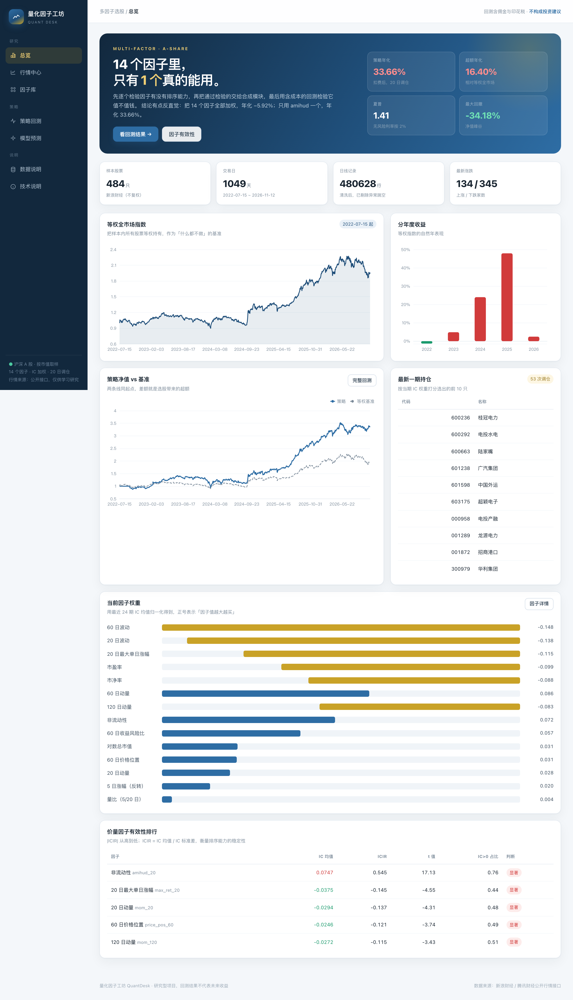
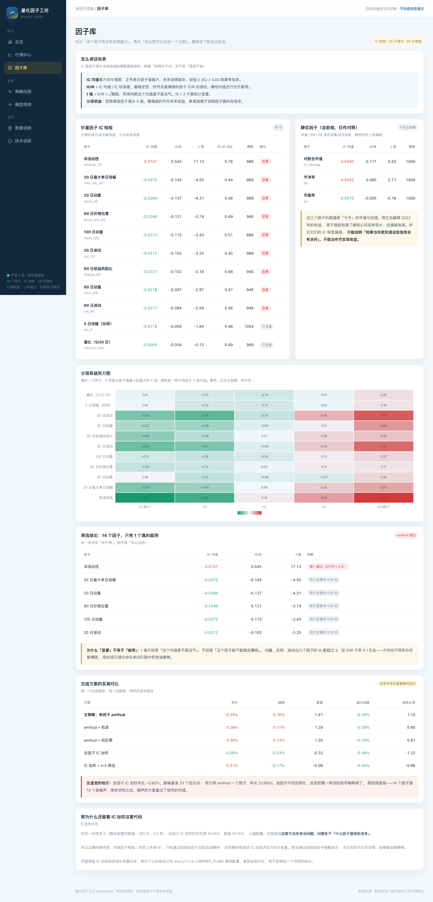
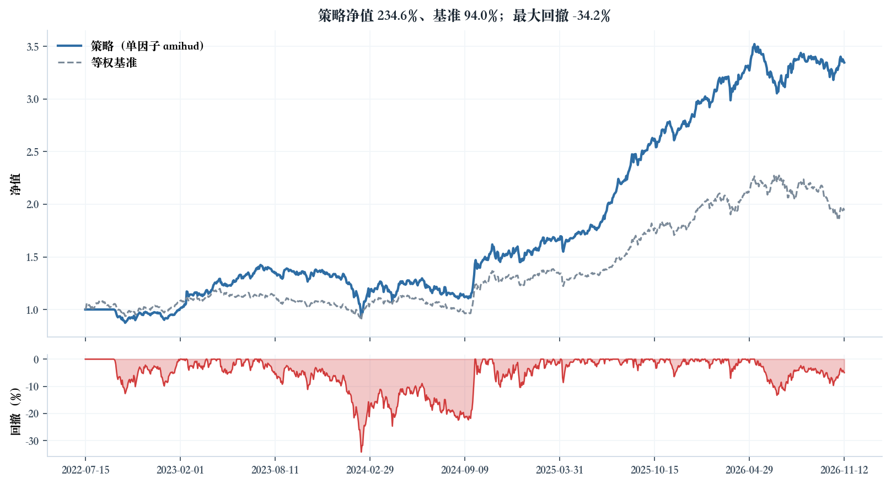
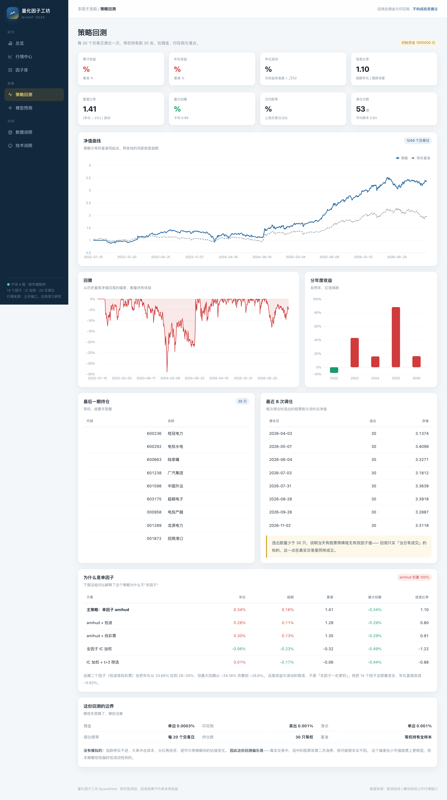
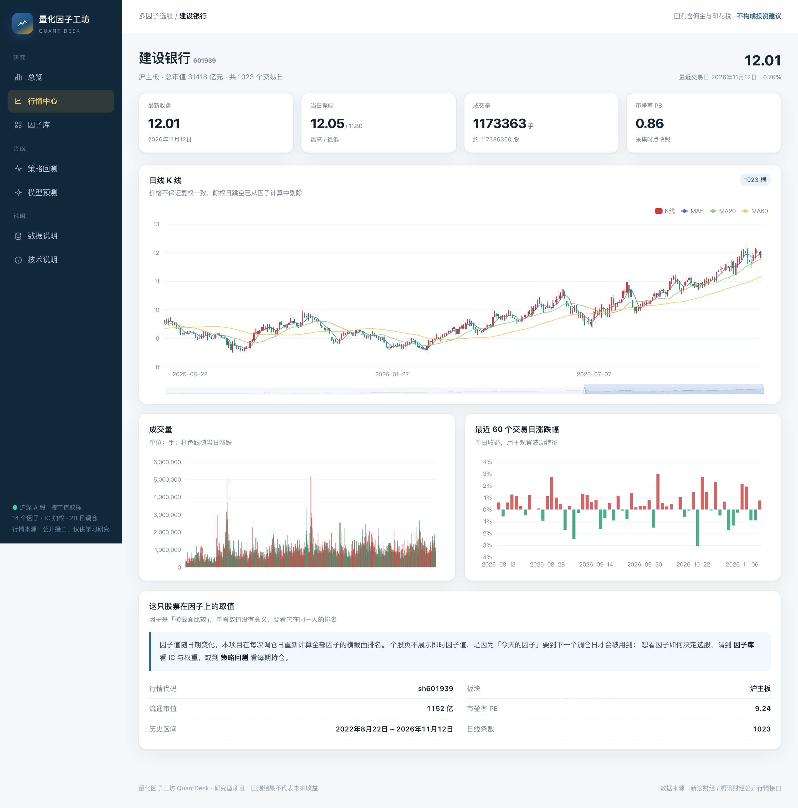
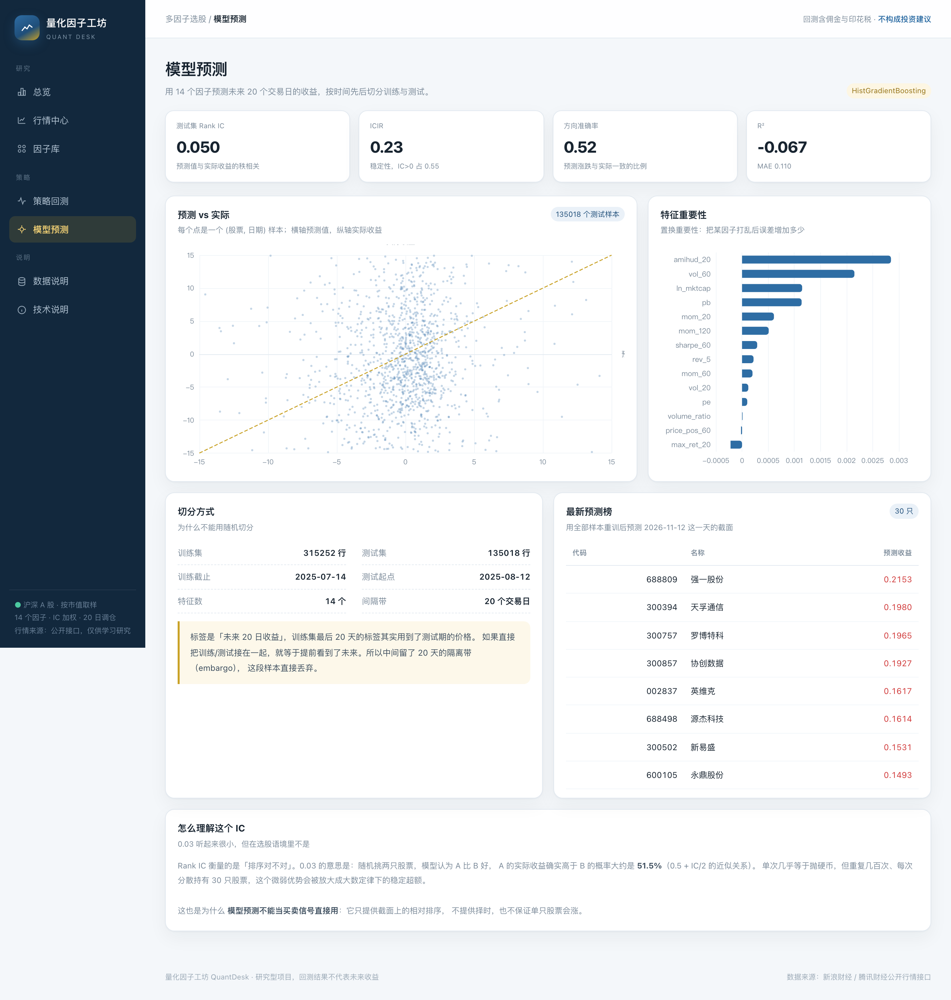
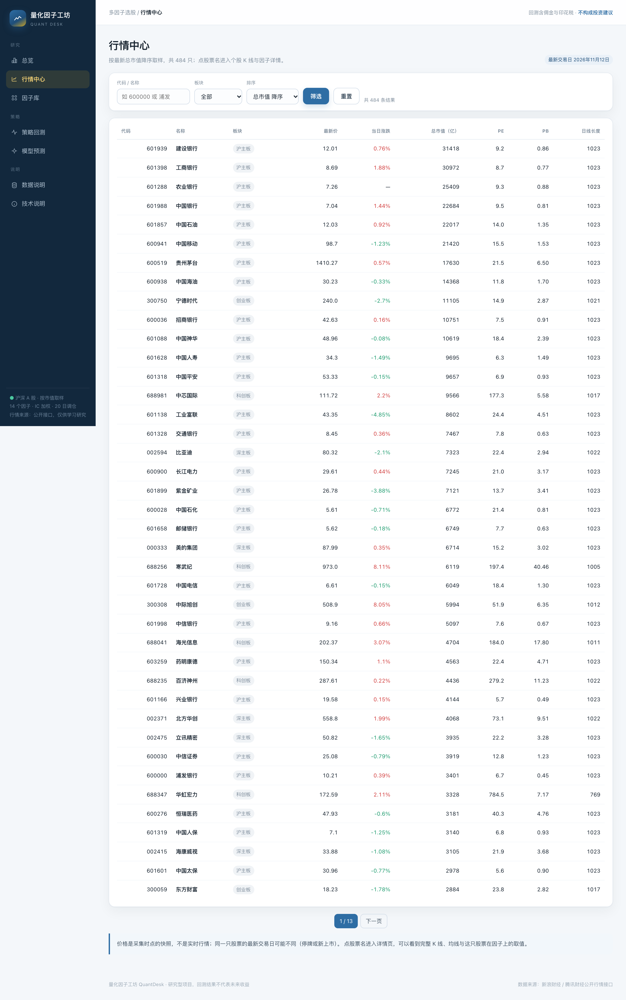
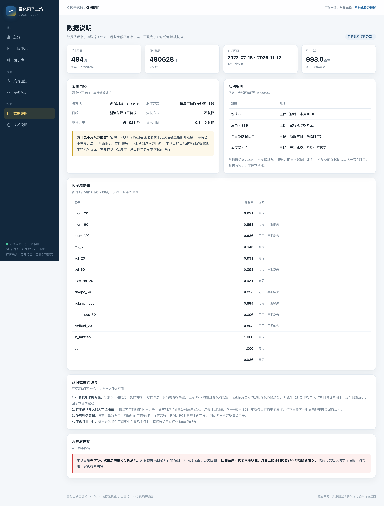

# A 股多因子量化选股与回测系统

先检验因子有没有用，再决定怎么用。14 个因子里只有 1 个通过检验，
而把 14 个全部加权反而跑输基准 23 个百分点 —— 这个反直觉的结论是本项目的主线。

**这是毕业设计的成果展示仓库**（截图 + 说明 + 交付清单），完整源码与文档见文末。



## 核心结论

同一个回测框架、同一份数据、同样的成本假设，只改变因子组合方式：

| 方案 | 年化 | 超额 | 夏普 | 最大回撤 | 信息比率 |
| --- | --- | --- | --- | --- | --- |
| **单因子 amihud（主策略）** | **33.66%** | **+16.40%** | **1.41** | -34.18% | 1.10 |
| amihud + 低波 | 28.27% | +11.01% | 1.28 | -28.59% | 0.80 |
| amihud + 低彩票 | 30.02% | +12.76% | 1.35 | -29.10% | 0.91 |
| 全因子 IC 加权 | **-5.92%** | **-23.18%** | -0.32 | -48.98% | -1.22 |
| IC 加权 + t>3 筛选 | 0.55% | -16.71% | -0.06 | -44.08% | -0.88 |

**加因子没有分散风险，只稀释了信号。** 14 个因子里 13 个是噪声，
等权求和之后噪声的方差盖过了信号的均值。

## 因子检验：14 个里只有 1 个能用

| 因子 | IC 均值 | ICIR | t 值 | 结论 |
| --- | --- | --- | --- | --- |
| **非流动性 amihud** | **0.0747** | **0.545** | **17.13** | **通过** |
| 20 日最大单日涨幅 | -0.0375 | -0.145 | -4.55 | 显著但 ICIR 低 |
| 20 日动量 | -0.0294 | -0.137 | -4.31 | 显著但 ICIR 低 |
| 60 日价格位置 | -0.0246 | -0.121 | -3.73 | 显著但 ICIR 低 |
| 120 日动量 | -0.0272 | -0.115 | -3.43 | 显著但 ICIR 低 |

判断标准：|IC| > 0.02、|ICIR| > 0.3、|t| > 2。

**「显著」不等于「可用」**：动量因子 t 值达到 -4.31（统计显著），
但 ICIR 只有 -0.137——它平均而言有点用，但方向在不同年份反复横跳。
把这种因子放进组合，会在来回打脸中把收益磨掉。



## 两个容易被忽略的坑

### 1. IC 加权的未来函数

第 t 期的 IC 要等 20 个交易日后的收益实现才算得出来。用它加权就是提前知道未来：

```python
def weights_at(ic_series, dates, idx, horizon=20, lookback=24):
    if idx - horizon - MIN_PERIODS < 0:
        return None
    cutoff = dates[idx - horizon]        # 关键：只用这天及之前的 IC
```

两项专门的测试保证这条防线没被绕过：

- `test_rolling_uses_past_only`：改掉最后 5 天价格，之前的 vol_20 不应变化
- `test_weight_uses_only_realized_ic`：截断 IC 序列后，当期权重应保持不变

### 2. 样本期风格与教科书相反

实测大盘股、高 PB、低流动性占优，与「小盘、低估值、流动性溢价」的先验不完全一致。
所以代码里所有因子都保留原始经济含义，由 IC 的符号决定权重方向，
而不是把错误先验硬编码进系统。

## 诚实报告边界

| 年份 | 策略 | 基准 | 超额 |
| --- | --- | --- | --- |
| 2022 | -8.32% | -1.28% | -7.04% |
| 2023 | +42.96% | +4.89% | +38.07% |
| 2024 | +15.86% | +24.01% | -8.15% |
| 2025 | +88.17% | +47.91% | +40.26% |
| 2026 | +16.27% | +2.47% | +13.80% |

5 年里 3 年跑赢、2 年跑输。**超额的四分之三来自 2023 与 2025 两年。**
信息比率 1.10 说明超额相对其波动是显著的，但这不是每年都能跑赢。

**回测没有模拟的**：涨跌停买不进、大单冲击成本、分红再投资、退市清算。
这些都会让结果偏乐观——而策略恰恰偏好低流动性标的，真实交易中更容易「想买买不到」。



## 界面

| 因子库（IC 检验 + 分层热力图 + 五方案对比） | 策略回测（净值 + 回撤 + 分年度） |
| --- | --- |
|  |  |

| 个股详情（K 线 + 均线 + 成交量） | 模型预测（Rank IC + 特征重要性） |
| --- | --- |
|  |  |

| 行情中心 | 数据说明 |
| --- | --- |
|  |  |

## 数据

| 指标 | 数值 |
| --- | --- |
| 样本股票 | 484 只（按总市值降序取样） |
| 日线记录 | 480,628 行 |
| 时间区间 | 2022-07-15 ~ 2026-11-12 |
| 交易日 | 1,049 天 |
| 数据源 | 新浪财经（不复权，1023 条）+ 腾讯财经（前复权，615 条，作校验） |

**为什么用不复权的长历史**：样本长度对因子研究更重要。除权跳空用收紧的涨跌阈值（15%）挡掉。

## 技术栈

Python 3.8+ · Django 4.2 · pandas 2.0 · NumPy · scikit-learn · SciPy · ECharts 5 · SQLite

刻意不依赖 LightGBM 与 TA-Lib：前者在 40 万样本、14 维特征上与 sklearn 的
HistGradientBoosting 差距很小，后者用 pandas 完全可以替代。

## 获取完整源码

完整交付包含：源码、48 万行行情数据、采集脚本、四件套文档（任务书 / 开题报告 / 论文 / 使用说明）、
8 张截图、7 张论文配图、90 秒演示视频。

- 成品页：https://bishe.suilang.net/products/quant-factor-lab
- 获取地址：https://mbd.pub/o/bread/YZaWlp5sag==
- 演示视频：https://www.bilibili.com/video/BV1cwWd6XEri/

论文 240 段 / 12 表 / 5 图，七章制；源码含 29 项单元测试。

## 合规声明

本项目是**教学与研究性质的量化分析系统**，数据来自公开行情接口，结论基于历史回测。
**回测结果不代表未来收益，任何内容都不构成投资建议。**
